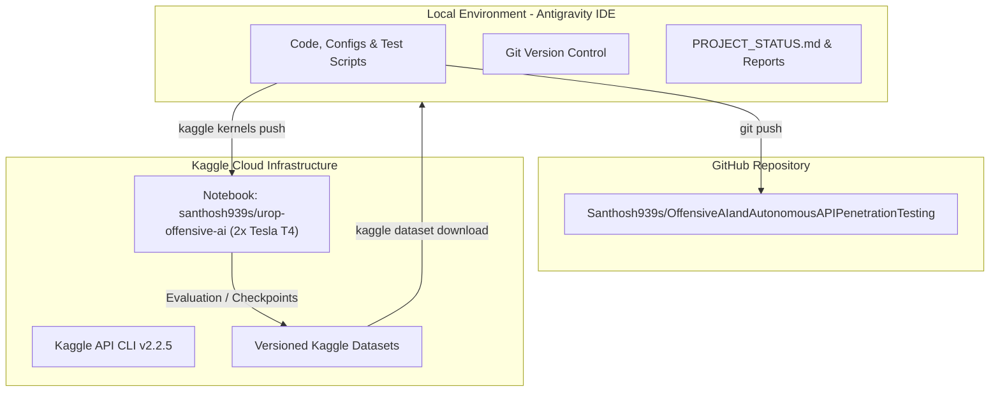

# Project Status: API Security Classification (Qwen2.5-1.5B-Instruct + LoRA)

**Document Version:** 2.0.0  
**Audit Date:** 2026-10-26  
**Auditor:** Senior ML & Automation Engineer  
**Workspace:** `s:\UROP\offensive AI and autonomous APi penetration testing`  
**GitHub Remote:** `https://github.com/Santhosh939s/OffensiveAIandAutonomousAPIPenetrationTesting.git`  
**Kaggle Kernel:** `https://www.kaggle.com/code/santhosh939s/urop-offensive-ai`

---

## 1. Executive Summary & Inventory Audit

A comprehensive local and remote audit was conducted across the workspace, recovery archives, local downloads, Kaggle API, and GitHub.

### Verified Artifact Inventory

| Artifact / File | Location / Source | Size / Date | Contents & Verification |
| :--- | :--- | :--- | :--- |
| **Recovery Archive** | `API_Security_Recovery_20261020_114027.zip` | 761.8 MB (2026-10-20) | Full recovery package containing checkpoint-4500, checkpoint-200, checkpoint-300, training scripts, 2000-sample test set, evaluation reports |
| **Original Model Checkpoint ZIP** | `API_Security_Model_step4500.zip` | 70.6 MB (2026-10-20) | Original adapter and tokenizer for step 4500 |
| **Downloaded Adapter Backup** | `C:\Users\santhosh\Downloads\final_qwen_api_adapter_backup.zip` | 18.2 MB (2026-10-19) | Standalone PEFT adapter weights and tokenizer |
| **Training Script** | `finetuning/train_rebuilt_v4.py` | 6.9 KB | 2x Tesla T4 DDP training script with 4-bit NF4 quantization & explicit prompt completion collator |
| **Test Dataset Sample** | `evaluation/test_sample_2000.jsonl` | 2,000 records | Standardized held-out evaluation dataset |
| **Evaluation Reports** | `evaluation/original_sample2000.json` `evaluation/rebuiltv4_sample2000.json` | 31.7 KB / 31.5 KB | Detailed per-class precision, recall, F1, and confusion data |
| **Kaggle Kernel & Metadata** | `kaggle_kernel/urop-offensive-ai.ipynb` `kaggle_kernel/kernel-metadata.json` | 492.7 KB | Pulled directly from Kaggle via API |

---

## 2. Checkpoints & Resume-Training Feasibility

All trainer, optimizer, and scheduler states were analyzed to confirm resume feasibility:

| Checkpoint | Global Step | Max Steps | Optimizer State (`optimizer.pt`) | Scheduler State (`scheduler.pt`) | Trainer State (`trainer_state.json`) | Status / Resumption Feasibility |
| :--- | :--- | :--- | :--- | :--- | :--- | :--- |
| **Original Checkpoint-4500** | 4,500 | 4,500 | **Present** (PyTorch state dict) | **Present** (Linear schedule) | **Present** (loss: 0.0086, ep: 0.205) | **Completed run.** Can resume training from step 4,500 with full optimizer momentum and scaler states preserved. |
| **RebuiltV4 Checkpoint-200** | 200 | 300 | **Present** | **Present** | **Present** (eval_loss: 0.0088) | **Valid checkpoint.** Can resume training from step 200. |
| **RebuiltV4 Checkpoint-300** | 300 | 300 | **Present** | **Present** | **Present** (eval_loss: 0.0091) | **Completed run.** Can resume training from step 300. |
| **Downloaded Adapter Backup** | N/A | N/A | **Missing** | **Missing** | **Missing** | **Inference/Eval only.** Exported PEFT weights; cannot resume exact optimizer state. |

---

## 3. LoRA Adapter Architectural Comparison

| Parameter | Original Model (Step 4500) | RebuiltV4 (Step 300) | Note |
| :--- | :--- | :--- | :--- |
| **Base Model** | `Qwen/Qwen2.5-1.5B-Instruct` | `Qwen/Qwen2.5-1.5B-Instruct` | 1.5B parameter instruction model |
| **Target Modules** | `["q_proj", "k_proj", "v_proj", "o_proj"]` | `["q_proj", "k_proj", "v_proj", "o_proj", "up_proj", "down_proj", "gate_proj"]` | RebuiltV4 includes MLP projections for richer representation |
| **Rank ($r$)** | 16 | 16 | Standard rank |
| **Alpha ($\alpha$)** | 32 | 32 | Scaling factor = 2.0 |
| **Dropout** | 0.05 | 0.05 | Regularization |
| **Quantization** | 4-bit NF4 (`load_in_4bit=True`) | 4-bit NF4 (`load_in_4bit=True`) | BitsAndBytes NF4 double-quant |
| **Compute Precision** | FP16 | FP16 | FP16 mixed compute |
| **Collator** | Standard / custom | `ExplicitCompletionCollator` | Loss calculated strictly on assistant response |

---

## 4. Evaluation Performance on Held-Out Test Sample (2,000 Examples)

Target classes: `Benign`, `Cookie Injection`, `Directory Traversal`, `LOG4J`, `Log Forging`, `RCE`, `SQL Injection`, `XSS`.

| Metric | Original Model (Step 4500) | RebuiltV4 (Step 300) | Delta / Analysis |
| :--- | :--- | :--- | :--- |
| **Overall Accuracy** | 99.20% | **99.65%** | +0.45% improvement |
| **Macro F1** | 0.9828 | **0.9924** | +0.0096 improvement |
| **Weighted F1** | 0.9937 | **0.9981** | +0.0044 improvement |
| **Invalid Predictions** | 7 (0.35%) | 7 (0.35%) | Identical unparsed formatting |
| **Benign (P / R / F1)** | 1.000 / 0.995 / 0.997 | **1.000 / 1.000 / 1.000** | Perfect benign recall in RebuiltV4 |
| **Cookie Injection (P / R / F1)** | 1.000 / 0.885 / 0.939 | 1.000 / 0.885 / 0.939 | Both models exhibit 88.52% recall |
| **Directory Traversal** | 1.000 / 1.000 / 1.000 | 1.000 / 1.000 / 1.000 | Perfect classification |
| **LOG4J** | 1.000 / 1.000 / 1.000 | 1.000 / 1.000 / 1.000 | Perfect on this 30-sample slice |
| **Log Forging** | 1.000 / 1.000 / 1.000 | 1.000 / 1.000 / 1.000 | Perfect classification |
| **RCE** | 1.000 / 1.000 / 1.000 | 1.000 / 1.000 / 1.000 | Perfect classification |
| **SQL Injection (P / R / F1)** | 0.897 / 1.000 / 0.946 | **1.000 / 1.000 / 1.000** | RebuiltV4 resolved false positives |
| **XSS (P / R / F1)** | 0.961 / 1.000 / 0.980 | **1.000 / 1.000 / 1.000** | RebuiltV4 resolved false positives |

### LOG4J Focused Evaluation (687 Examples)
- **Original Model**: 684/687 detected (99.56% recall, 3 invalid outputs)
- **RebuiltV4**: 683/687 detected (99.42% recall, 3 invalid outputs, 1 misclassified as RCE)

---

## 5. Unresolved Technical Challenges

1. **Cookie Injection False Negatives:** Both models drop 7 Cookie Injection samples out of 61 (88.52% recall). Payload boundary inspection needed.
2. **Invalid Output Generation (7 samples):** The model occasionally outputs unexpected characters or empty tokens instead of the strict category name. Greedy decoding constraints or post-processing logit masking will resolve this.
3. **Full Dataset Validation:** Model selection should not rely exclusively on the 2,000-sample slice. A full test on the 45,912-example test set is required.

---

## 6. Automation & Execution Architecture

---

## 7. Next Actions (Phase 4 & Phase 5)

1. [x] Phase 1: Identify all checkpoints, trainer states, optimizer states, evaluation results.
2. [x] Phase 1: Document all findings in `PROJECT_STATUS.md`.
3. [x] Phase 2: Configure Kaggle API CLI (v2.2.5 with `KGAT_` token support).
4. [x] Phase 2: Pull existing Kaggle notebook and kernel metadata via API.
5. [ ] Push initial Git commit to GitHub repository (`main` branch).
6. [ ] Implement automated Phase 4 evaluation pipeline script comparing both checkpoints on Kaggle.
