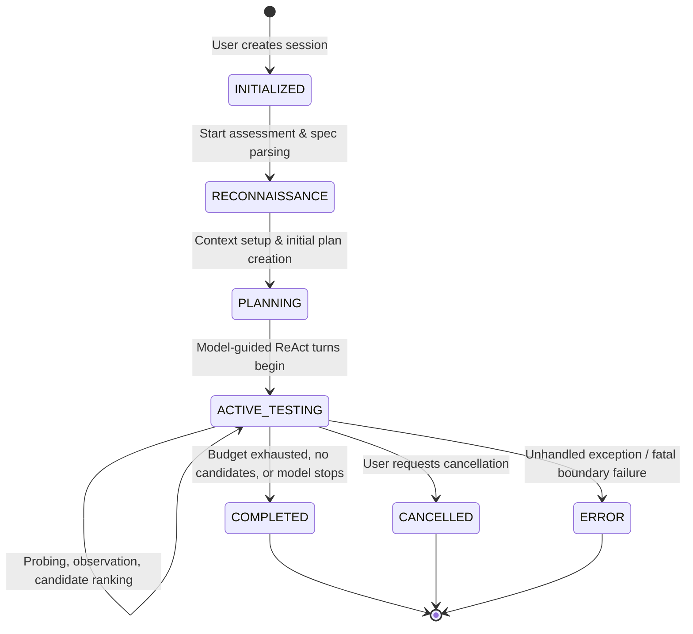
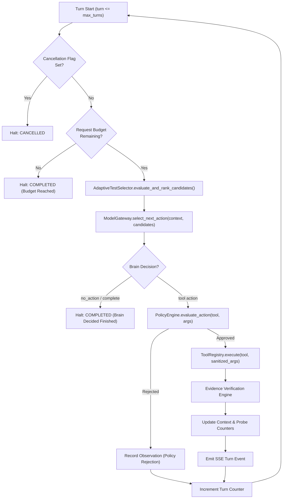
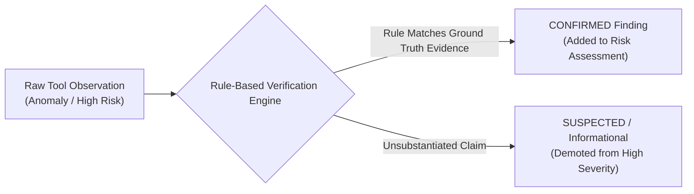

# Autonomous Agent Workflow & Decision Architecture

## 1. Executive Summary

The **Autonomous API Penetration Testing Controller** (`controller/agent/autonomous_controller.py`) coordinates multi-turn API security assessments. It combines heuristic endpoint prioritization, policy-enforced tool execution, local CPU-based LLM reasoning (`Qwen2.5-1.5B-Instruct`), deterministic evidence verification, and real-time SSE telemetry broadcasting.

The system guarantees that the AI model acts within safe operational constraints while adaptively discovering and proving real OWASP API Top 10 vulnerabilities.

---

## 2. Assessment State Machine

Each assessment progresses through a strict, deterministic lifecycle:

### State Definitions
1. **INITIALIZED**: Session registered in SQLite with target URL, authorized scope, request budget, and optional authentication headers.
2. **RECONNAISSANCE**: Target reachability check, OpenAPI spec ingestion (via `openapi_parser`), and GraphQL candidate detection. Discovered endpoints are registered into `CompactContextManager`.
3. **PLANNING**: High-level test plan formulated by `ModelBrainClient.create_test_plan()`, establishing primary attack surfaces and risk priorities.
4. **ACTIVE_TESTING**: Multi-turn ReAct loop iteratively selecting actions, validating against `PolicyEngine`, executing tools, gathering observations, and verifying findings.
5. **COMPLETED / CANCELLED / ERROR**: Assessment finalized; risk engine calculates scores; markdown, JSON, and HTML reports are generated; final SSE event emitted.

---

## 3. The ReAct (Reasoning + Acting) Execution Loop

Within the `ACTIVE_TESTING` state, each turn executes the following 8-step loop:

### Detailed Loop Steps:
1. **Guard Condition Checks**: Verify turn limit (`turn <= max_turns`), budget (`requests_made < max_requests`), and cancellation flag (`state.is_cancelled`).
2. **Adaptive Candidate Ranking**: `AdaptiveTestSelector` inspects all endpoints and past observations, computing information-gain priority scores:
   - Untested endpoints: `+3.0`
   - High-value attack surfaces (`auth`, `login`, `admin`, `user`): `+3.5` to `+4.0`
   - Parameterized paths: `+2.5`
   - Suspected vulnerability requiring verification: `+6.0`
   - Exhausted endpoints (probes exceeded limit): Filtered out (`0.0`)
3. **Model Brain Action Selection**: Top candidates, tool schemas, and recent observation history are presented to the Qwen model. The model outputs a structured JSON response specifying the chosen `tool_name`, `arguments`, and `rationale`.
4. **Guardrail Enforcement**: Proposed action parameters are evaluated by `PolicyEngine`. Non-conforming actions (out-of-scope URLs, dangerous operations) are blocked before network transmission.
5. **Execution & Receipt Generation**: Approved tools execute safely via `ToolRegistry`. HTTP traffic and timing metrics are captured.
6. **Deterministic Verification**: Potential vulnerabilities reported by the tool or model pass through verification rules before becoming confirmed findings.
7. **Context & Telemetry Update**: Endpoint status updated (`UNTESTED` -> `TESTED` -> `VULNERABLE`); observations appended; SSE event emitted to connected dashboards.
8. **Loop Advancement**: Iteration counter increments, and the loop repeats until stopping criteria are satisfied.

---

## 4. Stopping Conditions & Resource Ceilings

The controller deterministically terminates when any of the following occur:
- **Turn Ceiling**: Session reaches `max_turns` (default: 20 turns).
- **Request Budget Exhaustion**: Accumulated HTTP requests reach `max_requests_per_session` (default: 100 requests).
- **Endpoint Saturation**: All discovered endpoints reach `max_probes_per_endpoint` (default: 3 probes per endpoint).
- **Autonomous Convergence**: The model brain decides testing is complete and returns `"tool_name": "no_action"` or `"complete"`.
- **User Cancellation**: Explicit cancellation received from the dashboard (`/api/assessments/<id>/cancel`).
- **Consecutive Rejections**: If the model proposes 3 consecutive invalid or unapproved actions, the controller safely abstains.

---

## 5. Evidence Verification & State Transitions

To prevent false-positive hallucinated security findings, the controller enforces a deterministic verification rule set:

### Deterministic Rule Checks:
- **SQL Injection**: Verified only if database error syntax patterns (e.g. `syntax error near`, `sqlite3.OperationalError`, `unclosed quotation mark`) or deterministic boolean delay matches are observed in the response body.
- **BOLA / IDOR**: Verified only if User B's authentication credentials successfully retrieve User A's private resource identifiers with HTTP 200.
- **BFLA (Broken Function Level Authorization)**: Verified only if an unprivileged or unauthenticated request accesses an administrative endpoint (e.g. `/api/admin/users`) with HTTP 200/201.
- **Sensitive Business Flows**: Verified only if multi-request probe bursts succeed without encountering HTTP 429 (Too Many Requests) or rate-limit challenge headers.
- **Improper Inventory**: Verified only if non-production/shadow routes (`/beta/`, `/v1/`, `/swagger.json`) return valid structured payloads without authentication.

---

## 6. Real-Time Telemetry & SSE Streaming

Throughout the autonomous workflow, the controller uses `EventEmitter` (`controller/agent/event_emitter.py`) to stream events to subscribers:

- `assessment_started`: Triggered upon session initialization.
- `phase_changed`: Emitted when transitioning between reconnaissance, planning, testing, and completion.
- `turn_completed`: Carries turn number, action taken, tool name, response code, and latency.
- `finding_recorded`: Emitted immediately when a verified vulnerability is committed to the evidence store.
- `assessment_completed`: Emitted with final severity counts and report links.
- `assessment_error`: Emitted if an unexpected runtime failure occurs.

Subscribers consume these events via Server-Sent Events (SSE) at `GET /api/stream/<session_id>`, rendering a live real-time dashboard terminal.

