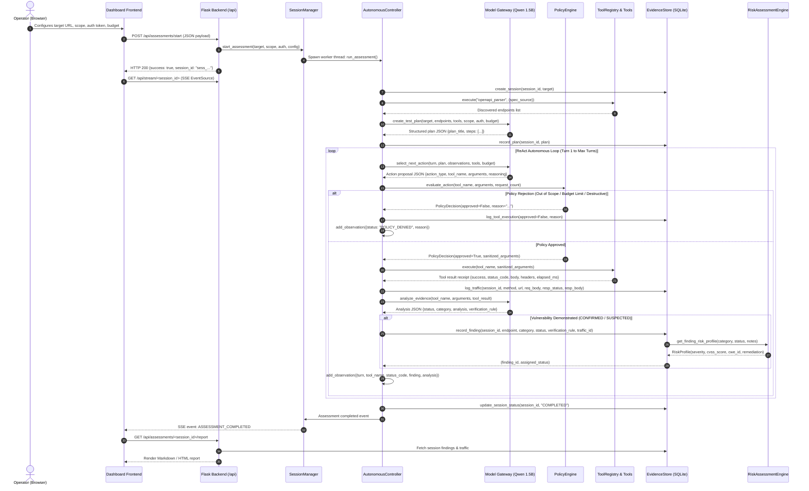

# Component Data Flow & Schema Specifications

This document defines the exact data schemas, protocol contracts, serialization formats, and error handling pathways operating between every interconnected component.

---

## 1. End-to-End Data Flow Sequence



---

## 2. Component Interface Schemas

### A. Dashboard Launch Payload (`POST /api/assessments/start`)
```json
{
  "target_url": "http://127.0.0.1:5050",
  "allowed_hosts": ["127.0.0.1", "localhost", "127.0.0.1:5050"],
  "assessment_name": "API Security Audit Campaign",
  "brain_mode": "local_cpu",
  "remote_endpoint": null,
  "spec_source": "http://127.0.0.1:5050/openapi.json",
  "auth_context": "Bearer eyJhbGciOiJIUzI1NiIsInR5cCI6IkpXVCJ9...",
  "max_turns": 10,
  "max_requests": 25,
  "max_model_calls": 20,
  "zap_active_scan": false
}
```

### B. Controller to Model Context (`create_test_plan` & `select_next_action`)
When invoking the Qwen model brain, raw secrets in `auth_context` are masked using `mask_sensitive_traffic_data`:
```json
{
  "current_turn": 2,
  "max_turns": 10,
  "target_url": "http://127.0.0.1:5050",
  "authorized_scope": ["127.0.0.1", "localhost"],
  "auth_context": "Bearer ***",
  "budget": {
    "turns_remaining": 8,
    "requests_remaining": 22
  },
  "current_objective": "API Security Audit Campaign",
  "plan_steps": [
    {
      "step_number": 1,
      "tool": "openapi_parser",
      "purpose": "Discover API routes",
      "parameters": {"spec_source": "http://127.0.0.1:5050/openapi.json"}
    }
  ],
  "recent_observations": [
    {
      "turn": 1,
      "tool_name": "openapi_parser",
      "target_endpoint": "GET /openapi.json",
      "status_code": 200,
      "success": true,
      "finding": null,
      "analysis": {"status": "NOT_DEMONSTRATED"}
    }
  ]
}
```

### C. Model Decision to Controller (`select_next_action` output)
```json
{
  "action_type": "execute_tool",
  "tool_name": "httpx_request",
  "arguments": {
    "method": "GET",
    "url": "http://127.0.0.1:5050/api/search?q='"
  },
  "reasoning": "Probe search endpoint for unhandled SQL syntax error indicators."
}
```

### D. Policy Decision Schema (`PolicyDecision`)
```python
@dataclass(frozen=True)
class PolicyDecision:
    approved: bool
    reason: str
    tool_name: str
    sanitized_arguments: Optional[Dict[str, Any]] = None
```

### E. Tool Execution Receipt
Returned by every registered tool in `ToolRegistry`:
```json
{
  "success": true,
  "status_code": 500,
  "status_reason": "INTERNAL SERVER ERROR",
  "elapsed_ms": 14.8,
  "url": "http://127.0.0.1:5050/api/search?q='",
  "method": "GET",
  "headers": {
    "content-type": "application/json",
    "server": "Werkzeug/3.0"
  },
  "body": "{\"error\": \"unrecognized token: '\"' in SQL statement\"}",
  "tool_name": "httpx_request"
}
```

### F. Finding Record & Risk Enrichment (`EvidenceStore.record_finding`)
```json
{
  "id": 1,
  "session_id": "sess_1762234000_a1b2c3",
  "endpoint": "http://127.0.0.1:5050/api/search",
  "category": "SQL Injection",
  "status": "CONFIRMED",
  "verification_rule": "SQL_SYNTAX_ERROR_MATCH",
  "severity": "CRITICAL",
  "cvss_score": 9.8,
  "cwe_id": "CWE-89",
  "remediation": "Use parameterized queries or prepared statements. Never concatenate user input directly into SQL strings."
}
```

---

## 3. Secret Masking & Sanitization Boundary
To prevent credentials from leaking into model reasoning traces, telemetry feeds, or frontend DOM elements, `mask_sensitive_traffic_data` is applied at three key boundaries:
1. **Model Prompt Boundary:** Replaces Bearer tokens, passwords, and API keys with `***` before prompt synthesis.
2. **Dashboard Traffic Inspection:** HTTP headers and request bodies returned via `GET /api/assessments/<id>/traffic` are sanitized before JSON serialization.
3. **Report Generation:** Secret headers and auth credentials in traffic evidence are masked before Markdown/HTML generation.

