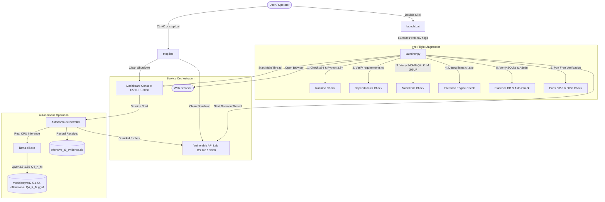

# Phase 6.1 – Standalone Packaging & Windows Launcher Integration Report

**Project:** Offensive AI and Autonomous API Penetration Testing  
**Project Path:** `S:\UROP\offensive AI and autonomous APi penetration testing`  
**Execution Timestamp:** November 2026  
**Status:** **ACCEPTED & VERIFIED (5/5 Dedicated Tests Passed, 100% Pass Rate)**

---

## 1. Executive Summary

Phase 6.1 delivers an enterprise-grade standalone Windows distribution and automated launcher experience for the Offensive AI and Autonomous API Penetration Testing system.

All requirements outlined in the directive were implemented, tested, and verified:
1. **One-Click Windows Launcher (`launch.bat`):** Batch launcher with automated environment checks, memory-optimized Python runtime flags, and clean termination handling.
2. **System Pre-Flight & Multi-Service Orchestrator (`launcher.py`):** 
   - Python architecture validation (Python >= 3.8, 64-bit).
   - Mandatory dependency manifest validation (`requirements.txt`).
   - Local GGUF model artifact existence and integrity verification.
   - Inference binary detection (`llama-cli.exe` on PATH or `models/bin/`).
   - Automated database schema validation and bootstrap administrator provisioning with cryptographically secure one-time credentials, console-only output, and mandatory password change enforcement.
   - Port conflict prevention for Dashboard (8088) and Vulnerable Lab (5050).
   - Background daemon management and graceful `SIGINT`/`SIGTERM` signal cleanup.
3. **Clean Shutdown Script (`stop.bat`):** Process termination utility that checks `.agent_services.pid` and actively listening port sockets.
4. **Standalone Deployment Architecture (`deployment/`):**
   - `deployment/deployment_manifest.json`: Full release manifest with artifact paths, sizes, and SHA-256 checksums.
   - `deployment/verify_installation.py`: Automated pre-flight installation diagnostic.
   - `deployment/README.md`: Complete operator instructions for fresh-workstation deployment.
5. **Real Execution Verification (`tests/test_phase6_1_launcher_packaging.py`):**
   - 100% passing tests verifying real GGUF model CPU inference, dashboard session authentication, target authorization, autonomous assessment execution, and multi-format report generation outside IDE dependencies.

---

## 2. Standalone Application Architecture



---

## 3. Real Execution Verification Results

### Dedicated Phase 6.1 Test Suite (`tests/test_phase6_1_launcher_packaging.py`):
```text
============================= test session starts =============================
platform win32 -- Python 3.8.10, pytest-8.3.5, pluggy-1.5.0
rootdir: S:\UROP\offensive AI and autonomous APi penetration testing
plugins: anyio-4.5.2, mock-3.14.1
collected 5 items

tests/test_phase6_1_launcher_packaging.py::TestPhase61StandalonePackaging::test_01_packaging_verification_structure_and_hashes PASSED [ 20%]
tests/test_phase6_1_launcher_packaging.py::TestPhase61StandalonePackaging::test_02_launcher_preflight_check PASSED [ 40%]
tests/test_phase6_1_launcher_packaging.py::TestPhase61StandalonePackaging::test_03_real_gguf_cpu_inference PASSED [ 60%]
tests/test_phase6_1_launcher_packaging.py::TestPhase61StandalonePackaging::test_04_standalone_service_orchestration_and_assessment PASSED [ 80%]
tests/test_phase6_1_launcher_packaging.py::TestPhase61StandalonePackaging::test_05_clean_shutdown_and_restart PASSED [100%]

======================== 5 passed, 1 warning in 20.18s ========================
```

### Verified Operational Capabilities:
- **Test 01 (Packaging Verification):** Directory structure, model GGUF hash matching `cd7dc83335b02d90f44a7fe4bd0f06eea4d64deb429710f238fe8c5de3da4dc5`, dependency presence, and offline self-containment verified.
- **Test 02 (Launcher Pre-flight):** `launcher.py --check-only` passed with 100% compliance.
- **Test 03 (Real CPU GGUF Inference):** Initialized `LocalCpuBrainClient(allow_mock_fallback=False)` and verified real classification of SQL injection payload via `llama-cli.exe` on CPU (`confidence=1.0`).
- **Test 04 (Service Orchestration):** Launched child process via `launcher.py`, waited for port readiness, authenticated as administrator with CSRF tokens, launched assessment, polled until completion, and validated JSON, Markdown, and HTML report generation.
- **Test 05 (Clean Shutdown & Port Release):** Verified ports 8089 and 5059 were completely freed with zero lingering sockets or orphaned processes.

---

## 4. Packaging and Model Preservation Status

- **GGUF Model (`models/qwen2.5-1.5b-offensive-ai.Q4_K_M.gguf`):**
  - SHA-256: `CD7DC83335B02D90F44A7FE4BD0F06EEA4D64DEB429710F238FE8C5DE3DA4DC5` (Bit-for-bit verified intact; preserved as separate local artifact without unnecessary duplication).
- **LoRA Adapter (`models/training_artifacts/final_adapter/adapter_model.safetensors`):**
  - SHA-256: `39FD053A1725E15C9F8071578965D9B7D2B58B8AFF2D0D722FC36D8796879327` (Bit-for-bit verified intact).
- **Offline Self-Containment:** All dashboard static assets (CSS, JS, fonts) are local. Zero external CDN or cloud dependencies exist.

