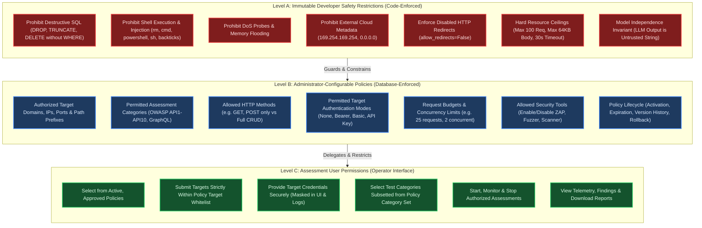
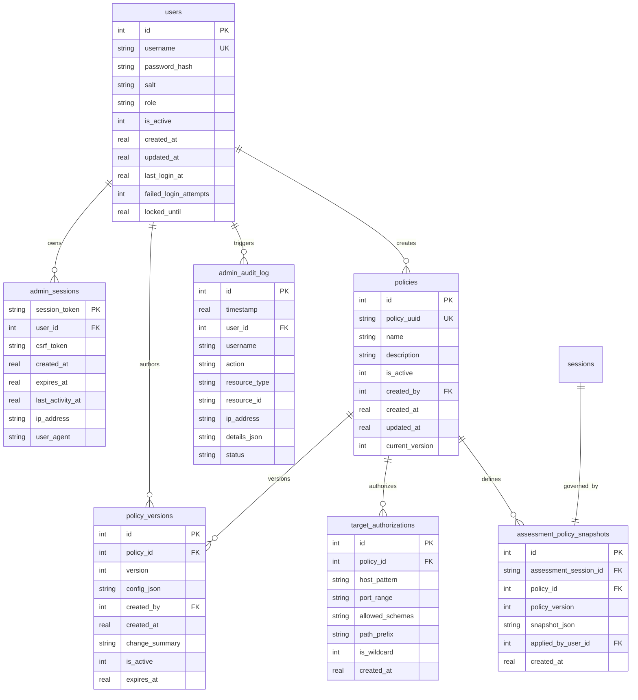

# Policy & Authorization Architecture Specification

**Project:** Offensive AI and Autonomous API Penetration Testing  
**Project Directory:** `S:\UROP\offensive AI and autonomous APi penetration testing`  
**Role:** Senior Security Architect, Application Security Engineer & Backend Architect  
**Date:** November 5, 2026  
**Document Status:** Complete Architecture Specification (Pre-Implementation)

---

## 1. Executive Summary & Existing Codebase Audit

### 1.1 Objective
This document defines the comprehensive architecture for a secure, role-based **Policy & Authorization Administration System**. It establishes a deterministic multi-tier policy hierarchy ensuring that the autonomous AI testing agent operates strictly within cryptographically verifiable, administrator-approved boundaries, while protecting developer safety invariants from modification or bypass.

### 1.2 Audit of Existing Implementations
A comprehensive inspection of the existing codebase revealed how security, scope, and tool execution currently function:

```
Existing Architecture Component Map:
-----------------------------------------------------------------------------------------
Component                   Current File Location                        Current Behavior & Limitations
-----------------------------------------------------------------------------------------
Policy Engine               controller/guardrails/policy_engine.py       Hard-coded dataclass rules (DEFAULT_CONFIG).
                                                                         Checks tool registration, argument schema,
                                                                         request budgets, and basic destructive SQL patterns.
Scope Validator             controller/guardrails/scope_validator.py     Hard-coded localhost check (127.0.0.1, localhost, ::1).
                                                                         Blocks AWS metadata (169.254.169.254).
                                                                         No database-backed target whitelist or multi-tenancy.
Tool Registry               controller/tools/registry.py                 In-memory registry of 9 security tools.
                            controller/tools/__init__.py                 Tools declare is_destructive=False, but no dynamic
                                                                         per-policy tool permissioning exists.
Autonomous Controller       controller/agent/autonomous_controller.py    Evaluates policy.evaluate_action() per turn.
                                                                         Rejects out-of-scope targets before session start.
                                                                         Feedbacks denials into LLM context as POLICY_DENIED.
Dashboard Server            dashboard/app.py                             Flask server on http://127.0.0.1:8088.
                                                                         Zero authentication, zero authorization, zero CSRF protection.
                                                                         All endpoints (/api/assessments/start, etc.) are unauthenticated.
Dashboard Session Manager   dashboard/session_manager.py                 Manages background threads, SSE streaming, concurrency limit (4).
                                                                         Accepts runtime parameters directly from caller.
Evidence Store & Database   controller/storage/evidence_store.py         SQLite database (offensive_ai_evidence.db).
                                                                         7 tables: sessions, plans, traffic_log, findings,
                                                                         tool_executions, specifications, zap_scans.
                                                                         Zero tables for users, roles, policies, or audit events.
User & Auth Handling        None                                         No web user accounts, password hashing, or web sessions.
                                                                         "Authentication" refers solely to target credentials.
Security Tests              tests/test_qa_phase3_auth_and_config.py      Tests target auth modes (Bearer, Basic, API Key, Custom).
                            tests/test_qa_phase6_security_robustness.py  Tests out-of-scope targets and budget limits.
-----------------------------------------------------------------------------------------
```

### 1.3 Key Architectural Gaps Identified
1. **Unauthenticated Dashboard Control Plane:** Any process or browser accessing port 8088 can start scans, cancel scans, read findings, and dump full traffic logs without credentials.
2. **Static Configuration Coupling:** Policies are instantiated directly from Python code (`AgentConfig` in `controller/config.py`). There is no mechanism for an administrator to define target scopes, allowed HTTP methods, or request budgets dynamically.
3. **Absence of Role Separation:** There is no distinction between a Security Administrator (who defines allowed targets, scopes, and safety boundaries) and an Assessment Operator (who executes assessments against approved targets).
4. **Lack of Policy Snapshotting:** When an assessment runs, its governing policy is not versioned or frozen in the database, making post-incident compliance audits ambiguous.
5. **Absence of Administrative Audit Logging:** Administrative modifications (e.g., whitelisting a new IP, changing request limits) are not recorded in any audit trail.

---

## 2. Multi-Level Policy Hierarchy

To achieve defense-in-depth, the policy architecture is structured into three strictly isolated tiers:



### 2.1 Level A: Immutable Developer Safety Restrictions
Level A restrictions represent non-negotiable physical and operational invariants embedded directly in application source code. **No administrator, dashboard configuration, database update, or AI model prompt can modify, disable, or override Level A restrictions.**

1. **Destructive Operation Blocking:**
   - Prohibits destructive database commands (`DROP TABLE`, `DROP DATABASE`, `TRUNCATE`, `DELETE FROM`, `UPDATE ... SET` without constraints, `SHUTDOWN`, `XP_CMDSHELL`).
   - Verified via deterministic regex filters in `PolicyEngine.DESTRUCTIVE_DB_PATTERNS`.
2. **Arbitrary Shell Execution Blocking:**
   - Prohibits command chaining characters (`[;&|`$><]`) and invocation of system binaries (`cmd`, `powershell`, `bash`, `sh`, `rm`, `curl`, `wget`, `nc`, `python`, `perl`).
   - Enforces directory traversal sanitization (`../`, `/etc/`, `windows/system32`).
3. **Denial-of-Service (DoS) Prevention:**
   - Per-endpoint probe ceiling: Maximum of 3 consecutive automated probes against any single endpoint path per session to prevent backend starvation.
   - Global concurrency ceiling: Maximum of 4 concurrent assessment sessions across the entire host.
4. **Cloud Metadata & Broadcast IP Block:**
   - Hardcoded blocklist for link-local and metadata addresses (`169.254.169.254`, `0.0.0.0`, `255.255.255.255`, multicast `224.0.0.0/4`).
5. **Scope Escape Prevention via HTTP Redirects:**
   - Both HTTP client adapters (`requests` in `http_request.py` and `httpx` in `httpx_client.py`) enforce `allow_redirects=False` and `follow_redirects=False`.
   - Any HTTP 301/302/307/308 response is captured as a static observation. The agent cannot follow redirects automatically; if the agent attempts to probe the redirected `Location`, it is treated as a completely new proposed action and evaluated independently against all Level A and Level B rules.
6. **Hard Resource Ceilings:**
   - Hard upper limit of 100 requests per session (even if an admin sets a higher value, Level A caps it).
   - Hard response body capture ceiling of 64 KB (preventing buffer exhaustion).
   - Hard HTTP timeout ceiling of 30.0 seconds per request.
7. **Model Independence Invariant:**
   - The AI model (Qwen GGUF) is strictly treated as an untrusted reasoning engine. Its outputs are structured strings that propose actions. The model possesses no execution authority. Every proposal must pass through the deterministic `PolicyEngine.evaluate_action()` pipeline before reaching any tool.

### 2.2 Level B: Administrator-Configurable Policies
Level B policies are created, versioned, activated, and retired by authenticated Administrators via the dedicated administration interface. These policies define operational rules for specific environments, teams, or projects.

- **Authorized Target Definitions:**
  - Whitelist of permitted hostnames (e.g., `127.0.0.1`, `localhost`, `staging-api.internal`).
  - Permitted port ranges (e.g., `5000-5055`, `8080`, `8443`).
  - Allowed schemes (`http`, `https`).
  - Allowed path prefixes (e.g., `/api/v1/`, `/graphql`).
- **Permitted Assessment Categories:**
  - Configurable subset of testing modules: OWASP API1:2023 (BOLA), API2:2023 (Broken Auth), API3:2023 (BOPLA), API4:2023 (Resource Consumption), API5:2023 (BFLA), API6:2023 (Business Logic), API7:2023 (SSRF), API8:2023 (Security Misconfig), API9:2023 (Improper Inventory), API10:2023 (Unsafe Consumption), GraphQL Introspection.
- **Allowed HTTP Methods:**
  - Configurable method set (e.g., restricted to `GET, POST` for read-heavy audits; or full `GET, POST, PUT, PATCH, DELETE, OPTIONS, HEAD` for comprehensive audits).
- **Permitted Target Authentication Modes:**
  - Allowlist of authentication modes operators may supply (`none`, `bearer`, `api_key`, `basic`, `custom`).
- **Operational Budgets:**
  - Max turns per assessment (1 to 25; default: 10).
  - Max requests per assessment (5 to 50; default: 25; capped by Level A at 100).
  - Max model reasoning calls (5 to 30; default: 25).
  - Assessment timeout (30 seconds to 600 seconds).
- **Tool Whitelist:**
  - Specific tools authorized for use (e.g., enable `http_request`, `jwt_inspector`, `openapi_parser`; disable `zap_scanner` and `parameter_fuzzer` in sensitive environments).
- **Policy Lifecycle & Versioning:**
  - Policies have unique UUIDs, sequential version numbers (`version`), activation states (`is_active`), creation timestamps, creator user IDs, and optional expiration timestamps (`expires_at`).
  - Editing an existing policy creates an immutable new version row in `policy_versions`. Previous versions are retained for audit and rollback.

### 2.3 Level C: Assessment User Permissions
Ordinary assessment operators interact with the testing platform within the boundaries pre-established by administrators.

- **Permitted Actions:**
  - Authenticate as an Operator.
  - View the list of active, approved policies assigned to their group.
  - Select an active policy for an assessment.
  - Input a target URL matching the approved target whitelist of the chosen policy.
  - Supply target credentials matching the permitted authentication types.
  - Select test categories from the policy's permitted category subset.
  - Launch, monitor live telemetry, pause, and cancel assessments.
  - View traffic logs, findings, risk summaries, and download generated reports.
- **Strict Prohibitions:**
  - Operators cannot create, modify, activate, or delete policies.
  - Operators cannot add target domains, expand IP ranges, or permit additional HTTP methods.
  - Operators cannot exceed the maximum request budgets or timeouts defined by the policy.
  - Operators cannot view or modify other users' credentials or administrative audit logs.

---

## 3. End-to-End Policy Enforcement Pipeline

Every proposed action—whether generated autonomously by the Qwen LLM, initiated by a tool sub-probe, or requested via an interactive API endpoint—must traverse the sequential policy evaluation pipeline:

```mermaid
sequenceDiagram
    autonumber
    participant Agent as Autonomous Controller / LLM
    participant Engine as PolicyEngine
    participant Safety as Level A: Safety Filter
    participant PolicyStore as Level B: Policy & Scope Store
    participant Tool as Tool Execution Registry
    participant Target as Target API

    Agent->>Engine: evaluate_action(tool_name, arguments, request_count)
    
    rect rgb(60, 20, 20)
        Note over Engine,Safety: Step 1: Level A Immutable Safety Checks
        Engine->>Safety: Validate Tool Name in Registry
        Safety-->>Engine: Tool Valid
        Engine->>Safety: Check Prohibited Shell Patterns & DB Traversal
        Safety-->>Engine: No Destructive Patterns
        Engine->>Safety: Check Hard Resource Limits (Count < 100)
        Safety-->>Engine: Within Hard Resource Ceiling
    end

    rect rgb(20, 40, 70)
        Note over Engine,PolicyStore: Step 2: Level B Policy & Scope Authorization
        Engine->>PolicyStore: Check Active Policy State & Expiration
        PolicyStore-->>Engine: Policy Active & Valid
        Engine->>PolicyStore: Check Tool Permitted in Active Policy
        PolicyStore-->>Engine: Tool Authorized
        Engine->>PolicyStore: Validate Target URL against Authorized Targets
        PolicyStore-->>Engine: Target Host, Port & Scheme Approved
        Engine->>PolicyStore: Check HTTP Method Permitted by Policy
        PolicyStore-->>Engine: Method Approved
        Engine->>PolicyStore: Check Policy Session Request Budget
        PolicyStore-->>Engine: Budget Available
    end

    alt Policy Denied at Any Step
        Engine-->>Agent: PolicyDecision(approved=False, reason="Scope violation / Denied by policy")
        Note over Agent: Logged to tool_executions; Fed back to LLM as POLICY_DENIED
    else Policy Fully Approved
        Engine-->>Agent: PolicyDecision(approved=True, sanitized_arguments)
        Agent->>Tool: execute(tool_name, sanitized_arguments)
        Tool->>Target: Outbound HTTP Request (allow_redirects=False)
        Target-->>Tool: HTTP Response (Status, Headers, Body)
        Tool-->>Agent: Structured Tool Execution Receipt
    end
```

### 3.1 Step-by-Step Validation Sequence
1. **Tool Registry Verification:** Confirms `tool_name` is registered in `ToolRegistry`.
2. **Schema & Argument Validation:** Confirms `arguments` matches the tool's parameter schema.
3. **Level A Command Injection & Path Traversal Guard:** Scans all string arguments against `PROHIBITED_COMMAND_PATTERNS`.
4. **Level A Destructive SQL Pattern Guard:** Scans payloads and query parameters against `DESTRUCTIVE_DB_PATTERNS`.
5. **Level A Global Ceiling Check:** Verifies current session request count < 100.
6. **Level B Policy Validity Check:** Verifies the session's governing policy is `is_active == 1` and has not passed `expires_at`.
7. **Level B Tool Whitelist Check:** Verifies `tool_name` is present in the policy's allowed tool list.
8. **Level B Target Scope Validation:**
   - Parses target URL using `urllib.parse.urlsplit`.
   - Rejects non-approved schemes (only schemes listed in policy; default: `http`, `https`).
   - Resolves target hostname/IP and matches against `target_authorizations` for the active policy.
   - Verifies target port falls within authorized port ranges.
   - Verifies path prefix matches authorized endpoint prefixes.
9. **Level B HTTP Method Authorization:** Confirms method is within policy `allowed_http_methods`.
10. **Level B Request Budget Validation:** Confirms session request count < policy `max_requests`.
11. **Level B Per-Endpoint Limit Validation:** Confirms endpoint probe count < policy `max_probes_per_endpoint` (default: 3).
12. **Sanitization & Normalization:** Normalizes URL, cleans redundant headers, and returns `PolicyDecision(approved=True, sanitized_arguments=...)`.

---

## 4. Administrator Authentication & Session Management Architecture

To secure the administration plane and prevent unauthorized policy alterations, a robust, offline-capable authentication system is designed:

```mermaid
flowchart LR
    subgraph Client["Browser Admin UI"]
        LoginForm["Login Form (User/Pass)"]
        AdminConsole["Admin Console (CSRF + Cookie)"]
    end

    subgraph AuthLayer["Backend Authentication Service"]
        RateLimiter["Rate Limiter (5 attempts / 15 min)"]
        PasswordVerifier["Argon2id / PBKDF2 Verifier"]
        SessionStore["Admin Session Store (SQLite)"]
        CSRFValidator["CSRF Token Validator"]
    end

    subgraph DB["Evidence Database (SQLite)"]
        UsersTable["users Table"]
        SessionsTable["admin_sessions Table"]
        AuditTable["admin_audit_log Table"]
    end

    LoginForm -->|POST /api/auth/login| RateLimiter
    RateLimiter -->|Pass| PasswordVerifier
    PasswordVerifier -->|Query Hash| UsersTable
    PasswordVerifier -->|Valid| SessionStore
    SessionStore -->|Insert Token| SessionsTable
    SessionStore -->|Log Event| AuditTable
    SessionStore -->|Set-Cookie: session_token (HttpOnly, SameSite=Strict)| Client

    AdminConsole -->|POST /api/admin/policy/* + X-CSRF-Token| CSRFValidator
    CSRFValidator -->|Validate Session & CSRF| SessionsTable
    CSRFValidator -->|Pass| DB
```

### 4.1 Security Specifications
- **No Hardcoded Credentials:** The application contains zero hardcoded default usernames or passwords.
- **Salted Password Hashing:** Passwords are protected using **PBKDF2-HMAC-SHA256** with **600,000 iterations** and a 32-byte cryptographically secure random salt (generated via `os.urandom(32)`), leveraging Python's standard library `hashlib` to maintain zero external C-dependencies in offline environments. (Optionally supports `argon2id` if installed).
- **First-Run Bootstrap Wizard / CLI:** On initial startup, if the `users` table contains zero administrator accounts, the system enters a bootstrap mode:
  - An emergency administrator bootstrap CLI tool is provided: `python -m controller.auth.bootstrap_admin --username <user>`.
  - Alternatively, a single-use setup token is printed to the local console on first launch, allowing the user to create the initial administrator password via the web UI. Once created, the setup token is invalidated immediately.
- **Session Tokens:**
  - 32-byte cryptographically secure random tokens generated via `secrets.token_urlsafe(32)`.
  - Stored in the `admin_sessions` SQLite table.
  - Delivered via an `HttpOnly`, `SameSite=Strict` cookie (`__Host-SessionToken` where supported).
  - Sliding session expiration: 30 minutes of inactivity; 8 hours absolute maximum lifetime.
- **CSRF Defense:**
  - Synchronizer Token Pattern: Upon successful login, a unique `csrf_token` is generated and returned to the client in a JSON payload.
  - Every state-changing administrative request (`POST`, `PUT`, `DELETE`) must transmit this token in the `X-CSRF-Token` header.
  - The server verifies that `header_csrf == session_csrf` before processing the request.
- **Brute-Force & Rate Limiting:**
  - In-memory and database-backed rate limiter: Maximum of 5 failed login attempts per username or IP address within a 15-minute window.
  - Accounts exceeding 5 failed attempts are locked for 15 minutes (`locked_until` timestamp).
  - Failed login attempts trigger progressive delays (exponential backoff: 1s, 2s, 4s, 8s).
- **Session Termination & Invalidation:**
  - `POST /api/auth/logout` immediately deletes the session row from `admin_sessions` and clears the client cookie.
  - Password change or account deactivation immediately purges all active sessions for that `user_id`.
- **Emergency CLI Recovery:**
  - A secure local script (`python -m controller.auth.reset_password --username <user>`) requires local OS shell access to reset forgotten administrator credentials without network dependency.
- **Administrative Audit Logging:**
  - Every administrative action (logins, failed attempts, policy creations, edits, target authorizations, rollbacks) is committed to `admin_audit_log` with user ID, username, action, timestamp, IP address, and JSON diffs.

---

## 5. Database Schema & Relational Design

The existing SQLite schema in `offensive_ai_evidence.db` (containing `sessions`, `plans`, `traffic_log`, `findings`, `tool_executions`, `specifications`, `zap_scans`) remains completely intact. Seven new relational tables are added to support the policy and authorization subsystem:



### 5.1 DDL Specifications for New Tables

```sql
-- 1. Users Table (Administrator & Operator Accounts)
CREATE TABLE IF NOT EXISTS users (
    id INTEGER PRIMARY KEY AUTOINCREMENT,
    username TEXT UNIQUE NOT NULL,
    password_hash TEXT NOT NULL,
    salt TEXT NOT NULL,
    role TEXT NOT NULL CHECK(role IN ('admin', 'operator', 'auditor')),
    is_active INTEGER NOT NULL DEFAULT 1,
    created_at REAL NOT NULL,
    updated_at REAL NOT NULL,
    last_login_at REAL,
    failed_login_attempts INTEGER DEFAULT 0,
    locked_until REAL
);

-- 2. Admin Sessions Table
CREATE TABLE IF NOT EXISTS admin_sessions (
    session_token TEXT PRIMARY KEY,
    user_id INTEGER NOT NULL,
    csrf_token TEXT NOT NULL,
    created_at REAL NOT NULL,
    expires_at REAL NOT NULL,
    last_activity_at REAL NOT NULL,
    ip_address TEXT,
    user_agent TEXT,
    FOREIGN KEY(user_id) REFERENCES users(id) ON DELETE CASCADE
);

-- 3. Policies Table
CREATE TABLE IF NOT EXISTS policies (
    id INTEGER PRIMARY KEY AUTOINCREMENT,
    policy_uuid TEXT UNIQUE NOT NULL,
    name TEXT NOT NULL,
    description TEXT,
    is_active INTEGER NOT NULL DEFAULT 1,
    created_by INTEGER NOT NULL,
    created_at REAL NOT NULL,
    updated_at REAL NOT NULL,
    current_version INTEGER NOT NULL DEFAULT 1,
    FOREIGN KEY(created_by) REFERENCES users(id)
);

-- 4. Policy Versions Table (Immutable Versioned Snapshots)
CREATE TABLE IF NOT EXISTS policy_versions (
    id INTEGER PRIMARY KEY AUTOINCREMENT,
    policy_id INTEGER NOT NULL,
    version INTEGER NOT NULL,
    config_json TEXT NOT NULL,
    created_by INTEGER NOT NULL,
    created_at REAL NOT NULL,
    change_summary TEXT,
    is_active INTEGER NOT NULL DEFAULT 1,
    expires_at REAL,
    FOREIGN KEY(policy_id) REFERENCES policies(id) ON DELETE CASCADE,
    FOREIGN KEY(created_by) REFERENCES users(id),
    UNIQUE(policy_id, version)
);

-- 5. Target Authorizations Table (Whitelist of Allowed Endpoints)
CREATE TABLE IF NOT EXISTS target_authorizations (
    id INTEGER PRIMARY KEY AUTOINCREMENT,
    policy_id INTEGER NOT NULL,
    host_pattern TEXT NOT NULL,
    port_range TEXT NOT NULL DEFAULT '1-65535',
    allowed_schemes TEXT NOT NULL DEFAULT 'http,https',
    path_prefix TEXT NOT NULL DEFAULT '/',
    is_wildcard INTEGER NOT NULL DEFAULT 0,
    created_at REAL NOT NULL,
    FOREIGN KEY(policy_id) REFERENCES policies(id) ON DELETE CASCADE
);

-- 6. Assessment Policy Snapshots Table (Frozen Policy Invariant per Assessment)
CREATE TABLE IF NOT EXISTS assessment_policy_snapshots (
    id INTEGER PRIMARY KEY AUTOINCREMENT,
    assessment_session_id TEXT NOT NULL UNIQUE,
    policy_id INTEGER NOT NULL,
    policy_version INTEGER NOT NULL,
    snapshot_json TEXT NOT NULL,
    applied_by_user_id INTEGER,
    created_at REAL NOT NULL,
    FOREIGN KEY(assessment_session_id) REFERENCES sessions(session_id),
    FOREIGN KEY(policy_id) REFERENCES policies(id),
    FOREIGN KEY(applied_by_user_id) REFERENCES users(id)
);

-- 7. Admin Audit Log Table
CREATE TABLE IF NOT EXISTS admin_audit_log (
    id INTEGER PRIMARY KEY AUTOINCREMENT,
    timestamp REAL NOT NULL,
    user_id INTEGER,
    username TEXT,
    action TEXT NOT NULL,
    resource_type TEXT NOT NULL,
    resource_id TEXT,
    ip_address TEXT,
    details_json TEXT,
    status TEXT NOT NULL CHECK(status IN ('SUCCESS', 'DENIED', 'FAILED')),
    FOREIGN KEY(user_id) REFERENCES users(id)
);

-- Indexes for Fast Lookups and Relational Integrity
CREATE INDEX IF NOT EXISTS idx_users_username ON users(username);
CREATE INDEX IF NOT EXISTS idx_admin_sessions_token ON admin_sessions(session_token);
CREATE INDEX IF NOT EXISTS idx_admin_sessions_expiry ON admin_sessions(expires_at);
CREATE INDEX IF NOT EXISTS idx_policies_active ON policies(is_active);
CREATE INDEX IF NOT EXISTS idx_policy_versions_lookup ON policy_versions(policy_id, version);
CREATE INDEX IF NOT EXISTS idx_target_auth_policy ON target_authorizations(policy_id);
CREATE INDEX IF NOT EXISTS idx_assessment_snapshot_session ON assessment_policy_snapshots(assessment_session_id);
CREATE INDEX IF NOT EXISTS idx_audit_log_timestamp ON admin_audit_log(timestamp DESC);
CREATE INDEX IF NOT EXISTS idx_audit_log_user ON admin_audit_log(user_id);
```

---

## 6. Dashboard Integration & UI Layout

The dashboard will be updated to include a dedicated **Policy & Authorization** tab (`🔐 Policy & Authorization`) in the sidebar navigation, keeping administrative controls strictly segregated from assessment operator views:

```
+--------------------------------------------------------------------------------------------------+
| OFFENSIVE AI | Autonomous API Penetration Testing Console                     [Admin: sysadmin] [Logout] |
+------------------+-------------------------------------------------------------------------------+
| 📊 Overview      | Policy & Authorization Administration                                          |
| 🎯 New Assessment| [ Policies ]  [ Target Whitelist ]  [ Audit Trail ]  [ New Policy ]            |
| ⚡ Live Activity  +-------------------------------------------------------------------------------+
| 🔍 Traffic Insp. | ACTIVE POLICIES (3)                                           [+ Create Policy]|
| 🚨 Findings      | +---------------------+---------+---------+------------+-------------+--------+ |
| 🌐 Endpoints     | | Policy Name         | Version | Targets | Categories | Req. Budget | Status | |
| 📑 Reports       | +---------------------+---------+---------+------------+-------------+--------+ |
| ⚖️ Compare Runs   | | Local Lab Standard  | v3      | 3 hosts | OWASP Top10| 25 requests | ACTIVE | |
| ⚙️ Diagnostics   | | Internal Microserv. | v1      | 1 host  | Auth, BOLA | 15 requests | ACTIVE | |
| 🔐 Policy & Auth | | Restricted ReadOnly | v2      | 2 hosts | Discovery  | 10 requests | ACTIVE | |
+------------------+ +---------------------+---------+---------+------------+-------------+--------+ |
| System Status:   |                                                                               |
| ● Ready (Offline)| POLICY DETAILS & VERSION HISTORY (Local Lab Standard - v3)                     |
| Brain: Local Qwen| Author: sysadmin | Created: 2026-11-05 14:30 | Expiry: None                    |
| ZAP: Standby     | Target Whitelist: 127.0.0.1:5000-5055, localhost:8080                         |
| Memory: 1.37 GB  | Allowed Tools: http_request, httpx_request, jwt_inspector, parameter_fuzzer    |
+------------------+ Allowed Methods: GET, POST, PUT, DELETE                                        |
                   | Version Diff: [v3 vs v2: Added parameter_fuzzer to allowed tools] [Rollback to v2]|
                   +-------------------------------------------------------------------------------+
```

### 6.1 State Management & Role-Based UI Rendering
1. **Unauthenticated Access:**
   - If an unauthenticated user clicks the `🔐 Policy & Authorization` tab, a clean, modal login panel is presented requesting `Username` and `Password`.
   - No administrative data, policy names, or audit records are delivered to the frontend until a valid session is established.
2. **Authenticated Administrator View:**
   - Displays the full administration panel with tabbed sub-views:
     - **Policy Overview:** Card grid and table of policies with inline toggle switches for activation/deactivation.
     - **Policy Editor:** Form for configuring target hosts, port ranges, allowed tools, request limits, and allowed categories.
     - **Target Authorization:** Interactive manager for whitelisted hostnames and IP blocks.
     - **Version History & Diff Viewer:** Visual side-by-side diff between policy versions with a one-click rollback button.
     - **Administrative Audit Log:** Real-time searchable audit table with date filters and event type selectors.
3. **Operator "New Assessment" Tab Integration:**
   - In the `New Assessment` tab, the free-form `Target URL` field is bound to an active policy selector.
   - When the operator selects an active policy, the target input dynamically validates that the proposed URL falls strictly within that policy's `target_authorizations`.
   - The test category checkboxes are automatically constrained to the subset permitted by the selected policy.
   - Request budgets and turn limits are pre-populated and cannot exceed the policy's limits.

---

## 7. Next Steps & Phase 5.2 Transition
This architecture specification serves as the formal foundation for the Policy & Authorization Administration system. Implementation tasks will proceed in Phase 5.2 according to the sequence established in [POLICY_AUTHORIZATION_IMPLEMENTATION_PLAN.md](file:///s:/UROP/offensive%20AI%20and%20autonomous%20APi%20penetration%20testing/docs/POLICY_AUTHORIZATION_IMPLEMENTATION_PLAN.md).

