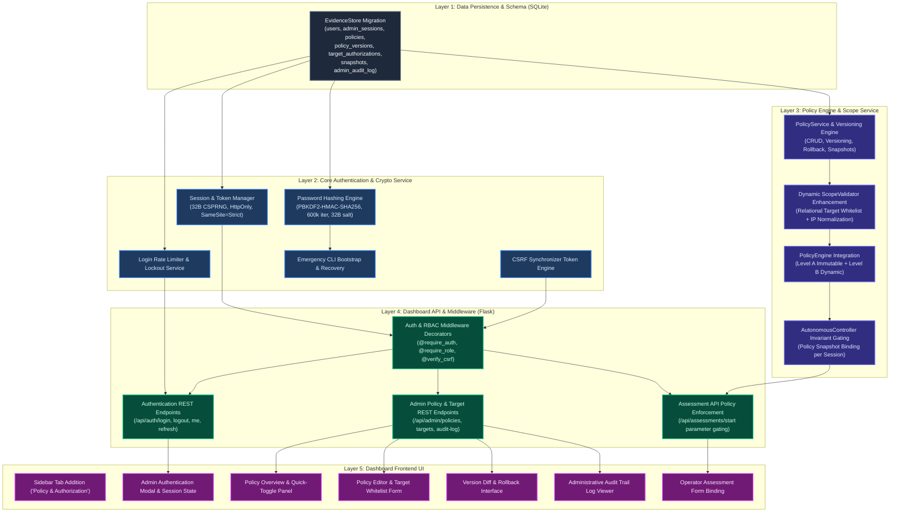

# Policy & Authorization Implementation Plan

**Project:** Offensive AI and Autonomous API Penetration Testing  
**Project Directory:** `S:\UROP\offensive AI and autonomous APi penetration testing`  
**Role:** Senior Security Architect, Application Security Engineer & Backend Architect  
**Date:** November 5, 2026  
**Document Status:** Complete Implementation Roadmap (Pre-Implementation)

---

## 1. Architectural Integration & Component Dependency Graph

The Policy & Authorization Administration system integrates across the entire application stack without breaking existing assessment pipelines, offline capabilities, or the local Qwen GGUF model workflow.



---

## 2. Distinction Between Existing vs. Proposed Implementations

```
Implementation Comparison Matrix:
-------------------------------------------------------------------------------------------------------------------------
Subsystem              Existing Implementation                                Proposed Implementation
-------------------------------------------------------------------------------------------------------------------------
Database Storage       EvidenceStore manages 7 tables (sessions, plans,        Non-destructively add 7 tables: users,
                       traffic_log, findings, tool_executions,                admin_sessions, policies, policy_versions,
                       specifications, zap_scans). No user or policy tables.  target_authorizations, snapshots, audit_log.
-------------------------------------------------------------------------------------------------------------------------
Authentication         Zero web authentication. Anyone accessing port 8088     Role-based authentication: Administrator vs.
                       has full control. Target credentials supported for      Operator. Salted PBKDF2 password hashing,
                       scans, but not user accounts.                          HttpOnly/SameSite session cookies, rate limiting.
-------------------------------------------------------------------------------------------------------------------------
CSRF Protection        None. All POST/PUT/DELETE endpoints accept raw          Double-Submit / Custom Header CSRF protection.
                       JSON without origin or CSRF tokens.                     State-mutating endpoints enforce X-CSRF-Token.
-------------------------------------------------------------------------------------------------------------------------
Policy Configuration   Static Python dataclass (AgentConfig, DEFAULT_CONFIG).   Dynamic database-backed PolicyService with
                       Parameters hardcoded in source.                         version history, audit logs, and diff/rollback.
-------------------------------------------------------------------------------------------------------------------------
Scope Enforcement      ScopeValidator checks static localhost set              ScopeValidator queries active policy's
                       (127.0.0.1, localhost, ::1) and blocks 169.254.169.254. target_authorizations table; validates schemes,
                                                                               ports, path prefixes, and canonical IP forms.
-------------------------------------------------------------------------------------------------------------------------
Assessment Execution   DashboardSessionManager accepts caller-provided limits  start_assessment requires an active policy_id;
                       directly into background AutonomousController.          freezes a policy snapshot in database; caps
                                                                               user inputs strictly to policy limits.
-------------------------------------------------------------------------------------------------------------------------
UI Interface           9 sidebar tabs. Free-form Target URL text input         Adds 10th sidebar tab ("Policy & Auth").
                       and manual turn/request sliders.                        Admin login card, policy cards, target manager,
                                                                               audit log. New Assessment binds to policy targets.
-------------------------------------------------------------------------------------------------------------------------
Audit Trail            Records tool execution and HTTP traffic only.           Adds admin_audit_log recording all administrative
                                                                               actions (logins, policy edits, target changes).
-------------------------------------------------------------------------------------------------------------------------
```

---

## 3. Ordered Implementation Tasks (By Dependency)

Implementation must follow a strict, dependency-ordered sequence. No downstream module will be developed before its foundational layer is fully verified by unit tests.

### Phase 5.2 - Step 1: Database Schema Migrations & EvidenceStore Extension
- **Task 1.1:** Update `EvidenceStore._init_db()` in [controller/storage/evidence_store.py](file:///s:/UROP/offensive%20AI%20and%20autonomous%20APi%20penetration%20testing/controller/storage/evidence_store.py) to idempotently create the 7 new tables:
  1. `users`
  2. `admin_sessions`
  3. `policies`
  4. `policy_versions`
  5. `target_authorizations`
  6. `assessment_policy_snapshots`
  7. `admin_audit_log`
- **Task 1.2:** Add indexes for fast lookup on `username`, `session_token`, `policy_id`, `created_at`, and `timestamp`.
- **Task 1.3:** Verify non-destructive execution: Ensure all existing assessment evidence, traffic logs, and findings in `offensive_ai_evidence.db` are completely preserved without data loss or corruption.
- **Task 1.4:** Add test suite `tests/test_evidence_store_schema_v2.py` verifying table creation, foreign keys, and indexes.

### Phase 5.2 - Step 2: Core Authentication, Password Hashing & Rate Limiting Engine
- **Task 2.1:** Create `controller/auth/crypto.py`:
  - Implement `hash_password(password: str) -> Tuple[str, str]` using PBKDF2-HMAC-SHA256 (600,000 iterations, 32-byte salt).
  - Implement `verify_password(password: str, salt_hex: str, hash_hex: str) -> bool` with `hmac.compare_digest`.
  - Zero external C-dependencies to preserve offline operation.
- **Task 2.2:** Create `controller/auth/session_manager.py`:
  - Implement `create_session(user_id, ip_address, user_agent) -> AdminSession`.
  - Implement `validate_session(session_token) -> Optional[User]`.
  - Implement `invalidate_session(session_token)`.
  - Implement sliding idle expiration (30 minutes) and hard expiration (8 hours).
- **Task 2.3:** Create `controller/auth/rate_limiter.py`:
  - Sliding-window attempt counter per IP and username.
  - Locks account for 15 minutes after 5 consecutive failures.
- **Task 2.4:** Create `controller/auth/bootstrap.py` and CLI tools:
  - `python -m controller.auth.bootstrap_admin` to create initial administrator without default passwords.
  - `python -m controller.auth.reset_password` for local offline administrative recovery.
- **Task 2.5:** Add test suite `tests/test_auth_crypto_and_sessions.py`.

### Phase 5.2 - Step 3: Policy Management & Dynamic Scope Service
- **Task 3.1:** Create `controller/guardrails/policy_service.py`:
  - Methods: `create_policy()`, `update_policy()`, `activate_policy()`, `deactivate_policy()`, `get_active_policies()`, `get_policy_by_id()`, `rollback_policy_version()`.
  - Every update commits an immutable row to `policy_versions` and writes an entry to `admin_audit_log`.
- **Task 3.2:** Enhance `ScopeValidator` in [controller/guardrails/scope_validator.py](file:///s:/UROP/offensive%20AI%20and%20autonomous%20APi%20penetration%20testing/controller/guardrails/scope_validator.py):
  - Support evaluating target URLs against an active policy's `target_authorizations` (host pattern, port range, scheme, path prefix).
  - Add canonical IP normalization (`ipaddress.ip_address`) to defeat hex, octal, decimal, and IPv6 obfuscation bypass attempts.
  - Maintain backward compatibility with default `AgentConfig` for standalone CLI usage.
- **Task 3.3:** Enhance `PolicyEngine` in [controller/guardrails/policy_engine.py](file:///s:/UROP/offensive%20AI%20and%20autonomous%20APi%20penetration%20testing/controller/guardrails/policy_engine.py):
  - Support binding to an active policy snapshot.
  - Enforce Level B restrictions (tool whitelist, allowed methods, allowed categories, session budget) dynamically, while strictly retaining Level A immutable safety guards.
- **Task 3.4:** Add test suite `tests/test_policy_service_and_versioning.py`.

### Phase 5.2 - Step 4: Autonomous Controller & Assessment Policy Snapshot Integration
- **Task 4.1:** Update `AutonomousController.run_assessment` in [controller/agent/autonomous_controller.py](file:///s:/UROP/offensive%20AI%20and%20autonomous%20APi%20penetration%20testing/controller/agent/autonomous_controller.py):
  - Accept `policy_id: Optional[str] = None` or `policy_snapshot: Optional[Dict[str, Any]] = None`.
  - On session start, freeze the governing policy configuration into `assessment_policy_snapshots`.
  - Pass the frozen snapshot to `PolicyEngine` so the session's rules remain completely immutable during assessment execution, immune to concurrent policy edits.
- **Task 4.2:** Update `DashboardSessionManager.start_assessment` in [dashboard/session_manager.py](file:///s:/UROP/offensive%20AI%20and%20autonomous%20APi%20penetration%20testing/dashboard/session_manager.py):
  - Validate that the target matches the chosen policy's authorized target list.
  - Bound turn limits, request budgets, and tool selection to the policy ceiling.
- **Task 4.3:** Add test suite `tests/test_assessment_policy_snapshot_binding.py`.

### Phase 5.2 - Step 5: Dashboard API Backend & Middleware Integration
- **Task 5.1:** Implement route security decorators in `dashboard/middleware.py`:
  - `@require_authenticated_user`: Verifies session token and activity window.
  - `@require_role('admin')`: Verifies administrative role.
  - `@verify_csrf_token`: Verifies `X-CSRF-Token` header matches active session token.
- **Task 5.2:** Add authentication endpoints to [dashboard/app.py](file:///s:/UROP/offensive%20AI%20and%20autonomous%20APi%20penetration%20testing/dashboard/app.py):
  - `POST /api/auth/login` (rate-limited, sets HttpOnly cookie, returns CSRF token and user profile).
  - `POST /api/auth/logout` (invalidates session, clears cookie).
  - `GET /api/auth/me` (returns current user profile and role).
- **Task 5.3:** Add administrative policy & target endpoints to [dashboard/app.py](file:///s:/UROP/offensive%20AI%20and%20autonomous%20APi%20penetration%20testing/dashboard/app.py):
  - `GET /api/admin/policies` (list all policies).
  - `POST /api/admin/policies` (create new policy).
  - `GET /api/admin/policies/<id>` (get policy details and version history).
  - `PUT /api/admin/policies/<id>` (update policy, creates new version).
  - `POST /api/admin/policies/<id>/activate` (activate/deactivate policy).
  - `POST /api/admin/policies/<id>/rollback` (rollback to specific version).
  - `GET /api/admin/audit-log` (query administrative audit logs with pagination).
- **Task 5.4:** Update `POST /api/assessments/start` to require policy validation and bind user identity.
- **Task 5.5:** Add test suite `tests/test_dashboard_auth_and_admin_api.py`.

### Phase 5.2 - Step 6: Frontend UI Components & Template Integration
- **Task 6.1:** Update [dashboard/templates/index.html](file:///s:/UROP/offensive%20AI%20and%20autonomous%20APi%20penetration%20testing/dashboard/templates/index.html):
  - Add sidebar button `<button class="nav-tab" data-tab="policy-admin"><span class="nav-icon">🔐</span> Policy & Auth</button>`.
  - Add section `<section id="tab-policy-admin" class="tab-pane">` containing:
    1. Unauthenticated Login Card.
    2. Authenticated Admin Console (Sub-tabs: Policies, Targets, Audit Trail, Create Policy).
  - Add User Badge and Logout button in the top bar.
- **Task 6.2:** Update [dashboard/static/js/dashboard.js](file:///s:/UROP/offensive%20AI%20and%20autonomous%20APi%20penetration%20testing/dashboard/static/js/dashboard.js):
  - Manage authentication state, CSRF token storage in memory (never localStorage), and automatic header injection (`X-CSRF-Token`).
  - Render policy table, target manager, version diff cards, and audit log table.
  - Update `New Assessment` tab to populate an "Approved Policy" dropdown and dynamically validate target URLs against the selected policy's targets.
- **Task 6.3:** Update [dashboard/static/css/dashboard.css](file:///s:/UROP/offensive%20AI%20and%20autonomous%20APi%20penetration%20testing/dashboard/static/css/dashboard.css):
  - Add styles for admin login card, policy cards, version comparison pill badges, and audit log tables.

### Phase 5.2 - Step 7: End-to-End Verification & Master Cumulative Notebook Update
- **Task 7.1:** Execute complete test suite covering all units, API endpoints, and end-to-end policy lifecycles.
- **Task 7.2:** Verify that all 234 existing tests remain 100% passing.
- **Task 7.3:** Verify offline execution: zero external network calls during authentication or policy administration.
- **Task 7.4:** Append Part XX to [urop_offensive_ai_master_all_executions.ipynb](file:///s:/UROP/offensive%20AI%20and%20autonomous%20APi%20penetration%20testing/urop_offensive_ai_master_all_executions.ipynb) documenting the implementation and verification.

---

## 4. Deliverable Verification & Next Steps

### Completed Milestones
- **Phase 5.1 (Policy & Authorization Architecture Audit):** Completed & Approved.
- **Phase 5.2 (Secure Administrator Authentication Implementation):** Completed & Approved (257 passing tests, PBKDF2-HMAC-SHA256, constant-time verification, session management, CSRF defense, remote protection).
- **Phase 5.3 (PolicyService and Target Authorization Engine):** Completed & Verified (292 passing tests).
  - 4 SQLite tables + indexes (`policies`, `policy_versions`, `target_authorizations`, `assessment_policy_snapshots`).
  - `PolicyService` with strict schema validation, immutable versioning, rollback, target whitelisting, and snapshots.
  - `ScopeValidator` with canonical IP parsing, Layer 1 non-overridable safety, DNS resolution/rebinding defense, and redirect revalidation.
  - `PolicyEngine` & `AutonomousController` integrated with snapshot binding and pre-assessment authorization.
  - Full test suites: `test_policy_service.py`, `test_target_authorization.py`, `test_policy_enforcement.py`.

- **Phase 5.4 (Policy Management API & Dashboard UI Integration):** Completed & Verified (323 passing tests).
  - 14 authenticated REST API endpoints in `dashboard/app.py` for policy CRUD, versioning, rollback, targets, and audit trail.
  - Role gating (`admin` only for mutations) and CSRF protection (`X-CSRF-Token`).
  - Interactive dashboard UI in `dashboard/templates/index.html`, `dashboard/static/js/dashboard.js`, `dashboard/static/css/dashboard.css`.
  - Metrics cards, searchable policy table, editor modal, target whitelist manager, version diff/rollback, audit log.
  - Operator scan integration: active policy selector and client-side target scope pre-validation.
  - Comprehensive test suite in `tests/test_dashboard_policy_management.py` (17 tests, 100% pass rate).

### Next Milestone
- **Phase 5.5 (Policy Enforcement Verification & Lab Penetration Testing):** Conduct real-world autonomous penetration testing simulations against the local API lab using custom policy configurations, verifying strict runtime adherence, budget cutoffs, and audit logging.


