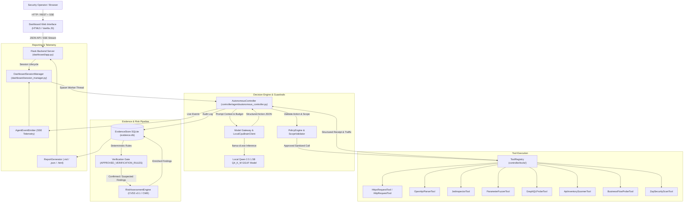

# System Architecture: Offensive AI & Autonomous API Penetration Testing

## 1. System Overview & Core Objective
The Offensive AI and Autonomous API Penetration Testing application is a standalone, CPU-optimized, closed-loop penetration testing platform. It uses a fine-tuned Qwen 2.5 1.5B Instruct model (quantized to 4-bit Q4_K_M GGUF format) to autonomously perform security assessments against REST and GraphQL APIs.

The system is designed to run entirely on ordinary Windows hardware (Intel i3-class CPU, 8 GB RAM, integrated graphics, zero NVIDIA GPU requirement, no remote GPU tunnels, and full offline functionality).

---

## 2. High-Level Architecture Diagram

---

## 3. Core Component Responsibilities & Boundaries

### A. Dashboard Frontend (`dashboard/templates/index.html`, `dashboard/static/js/dashboard.js`)
* **Role:** Single-page operator interface providing live telemetry, assessment launching, active sessions table, traffic inspection with credential masking, endpoints inventory, findings drilldown, and multi-format report exports.
* **Interface:** REST API calls (fetch) and unidirectional Server-Sent Events (`EventSource` on `/api/stream/<session_id>`).
* **Security Boundary:** Masks sensitive tokens (`Bearer ***`, passwords) on client-side rendering.

### B. Flask Backend Server (`dashboard/app.py`)
* **Role:** Exposes REST endpoints for assessment lifecycle, system health diagnostics, telemetry streaming, finding retrieval, and report downloading.
* **Endpoints:**
  * `POST /api/assessments/start`: Validates target, scope, budget, auth context, launches assessment worker.
  * `GET /api/assessments/<session_id>/status`: Returns turn count, requests sent, findings count, current phase.
  * `POST /api/assessments/<session_id>/cancel`: Cooperatively halts running assessment.
  * `GET /api/assessments/<session_id>/findings`: Returns verified and suspected vulnerability records.
  * `GET /api/assessments/<session_id>/traffic`: Returns sanitized HTTP traffic logs.
  * `GET /api/assessments/<session_id>/report`: Returns Markdown assessment report.
  * `GET /api/assessments/<session_id>/report/json`: Returns structured audit JSON.
  * `GET /api/assessments/<session_id>/report/html`: Returns standalone styled HTML report.
  * `GET /api/assessments/<session_id>/risk`: Aggregates session CVSS/CWE risk metrics.
  * `GET /api/assessments/<session_id>/endpoints`: Discovered endpoints inventory.
  * `GET /api/stream/<session_id>`: SSE stream of `AgentEventEmitter` events.

### C. Dashboard Session Manager (`dashboard/session_manager.py`)
* **Role:** Coordinates background threads running `AutonomousController`, manages event queues for SSE subscribers, enforces localhost scope on input, and provides credential sanitization (`mask_sensitive_traffic_data`).
* **Error Boundary:** Captures worker exceptions, records `status="ERROR"` with error diagnostics in the database, and prevents orphaned threads.

### D. Autonomous Controller (`controller/agent/autonomous_controller.py`)
* **Role:** Central ReAct orchestrator driving closed-loop reconnaissance, test planning, action selection, policy validation, tool dispatch, observation ingestion, and evidence verification.
* **Lifecycle:**
  1. `RECONNAISSANCE`: Ingests OpenAPI schema or GraphQL introspection to populate endpoint seeds.
  2. `PLANNING`: Model generates structured test plan with concrete parameter hypotheses.
  3. `EXECUTION`: ReAct loop iterates while within `max_turns` and `max_requests_per_session`.
  4. `REPORTING`: Synthesizes findings, calculates risk ratings, and updates database session status.

### E. Model Gateway & Inference Brain (`controller/brain/`)
* **`LocalCpuBrainClient` (`controller/brain/local_cpu_client.py`):** Standalone offline CPU inference invoking `llama-cli.exe` with `qwen2.5-1.5b-offensive-ai.Q4_K_M.gguf`. Bounded resource limits: `n_ctx=4096`, `n_threads=2..4`, `n_batch=128`, `use_mmap=True` (<1.5 GB RSS memory working set).
* **`DeterministicMockBrainClient` (`controller/brain/model_gateway.py`):** Fast deterministic mock brain for unit tests, development, and offline regression verification.
* **Resilient JSON Parser (`extract_and_validate_json`):** 6-tier fallback parser supporting direct JSON, Markdown fenced blocks, outermost brace matching, relaxed trailing commas, balance quote/brace repairs, and regex field extraction.

### F. Policy Engine & Scope Guardrails (`controller/guardrails/`)
* **`ScopeValidator`:** Deterministically enforces IP and hostname whitelisting (defaults to `127.0.0.1`, `localhost`, `::1`). Blocks arbitrary public IP ranges and external domains.
* **`PolicyEngine`:** Pre-execution authorization gate. Checks tool authorization, argument schemas, cumulative request limits, prohibited shell injection metacharacters (`;&|$\`><`), destructive SQL patterns (`DROP`, `TRUNCATE`, `DELETE`, `UPDATE`), and target URLs for all active tools.

### G. Tool Registry (`controller/tools/`)
* **Role:** Standardized execution interface (`BaseTool`).
* **Approved Default Tools:**
  1. `HttpRequestTool` (`http_request`): Standard synchronous HTTP request engine.
  2. `HttpxRequestTool` (`httpx_request`): High-performance HTTP client with timing, redirect suppression, and size capping.
  3. `OpenApiParserTool` (`openapi_parser`): Ingests OpenAPI 2.0 / 3.0 specs and generates planning endpoints.
  4. `JwtInspectorTool` (`jwt_inspector`): Offline decoding and structural inspection of JWT claims/headers.
  5. `ParameterFuzzerTool` (`parameter_fuzzer`): Non-destructive parameter boundary testing.
  6. `ZapSecurityScanTool` (`zap_scanner`): Integrates with OWASP ZAP daemon (passive scanning, spidering, active scanning overrides).
  7. `GraphQLProbeTool` (`graphql_probe`): Queries GraphQL endpoints for schema introspection (`__schema`).
  8. `ApiInventoryScannerTool` (`inventory_scanner`): Discovers shadow, undocumented, and legacy v1 API endpoints.
  9. `BusinessFlowProbeTool` (`business_flow_probe`): Tests sensitive business logic endpoints for discount stacking and missing anti-automation controls.

### H. Evidence Store & Verification Gate (`controller/storage/evidence_store.py`)
* **Role:** Thread-safe SQLite persistence (`sessions`, `plans`, `specifications`, `traffic_log`, `tool_executions`, `zap_scans`, `findings`).
* **Verification Gate Invariant:** Findings can **never** be marked `CONFIRMED` based solely on model assertion. Confirmation strictly requires documented traffic log evidence and an approved verification rule (`APPROVED_VERIFICATION_RULES`). Unverified claims are automatically demoted to `SUSPECTED`.

### I. Risk Engine & Reporting (`controller/reporting/`)
* **`RiskAssessmentEngine` (`risk_engine.py`):** Deterministically maps vulnerability categories to CVSS v3.1 base scores, CWE IDs, and OWASP API Security Top 10 (2023) categories. Calculates overall session risk score and executive rating.
* **`ReportGenerator` (`report_generator.py`):** Produces structured Markdown, formatted JSON, and self-contained styled HTML assessment reports.

