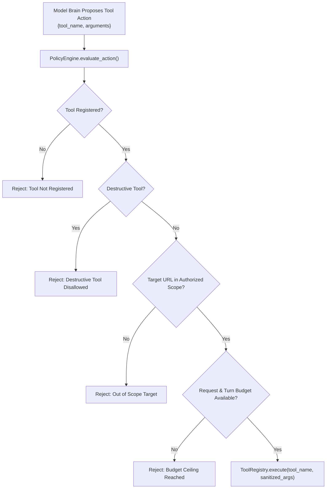

# Tool Integration & Standard Execution Interface

## 1. Overview and Core Philosophy

In the **Offensive AI and Autonomous API Penetration Testing** framework, all security scanning, active probing, and schema exploration capabilities are encapsulated as modular tools registered in the `ToolRegistry` (`controller/tools/registry.py`). 

Tools adhere to key design rules:
1. **Deterministic Isolation**: Tools never mutate external infrastructure without explicit authorization. Safe, non-destructive probing payloads are strictly enforced.
2. **Standardized Contract**: Every tool subclasses `BaseTool` or implements `ToolDefinition`, providing an input parameter schema and returning a structured execution receipt (`Dict[str, Any]`).
3. **Fail-Safe Policy Interception**: Prior to execution, every tool invocation proposed by the AI model brain is intercepted and evaluated by `PolicyEngine` (`controller/guardrails/policy_engine.py`). If the proposed target, URL, or method violates the defined assessment scope or safety rules, it is rejected deterministically before any network transmission occurs.
4. **Structured Evidence Recording**: Every tool output is persisted to SQLite via `EvidenceStore.log_tool_execution()`, generating an immutable audit trail.

---

## 2. Registered Tools Inventory

The default registry (`build_default_tool_registry()` in `controller/tools/__init__.py`) configures 9 approved security tools:

| Tool Name | Class | OWASP Category | Destructive? | Primary Purpose |
| :--- | :--- | :--- | :--- | :--- |
| `http_request` | `HttpRequestTool` | Multi-category | No | Low-level synchronous HTTP probe with custom headers, query params, and body |
| `httpx_request` | `HttpxRequestTool` | Multi-category | No | High-performance HTTP client supporting single and batch endpoint probing |
| `openapi_parser` | `OpenApiParserTool` | Discovery & Recon | No | Ingests, parses, and normalizes OpenAPI 2.0 / 3.x specifications |
| `jwt_inspector` | `JwtInspectorTool` | API2: Broken Auth | No | Parses JWT headers/payloads, flags weak algorithms (`none`, `HS256` flaws), and audits token structure |
| `parameter_fuzzer`| `ParameterFuzzerTool` | API3, API8, API10 | No | Injects non-destructive test vectors (SQLi, XSS, SSRF canary, command injection) into endpoints |
| `graphql_probe` | `GraphQLProbeTool` | API8, API4 | No | Tests GraphQL endpoints for schema introspection, field enumeration, and query depth/complexity limits |
| `inventory_scanner`| `ApiInventoryScannerTool`| API9: Improper Inventory | No | Probes for shadow/unversioned endpoints, legacy API versions (`v1`, `v2`, `beta`), and undocumented paths |
| `business_flow_probe`| `BusinessFlowProbeTool`| API6: Business Flows | No | Tests endpoints against rapid automated multi-request sequences to evaluate business flow rate limits |
| `zap_security_scan`| `ZapSecurityScanTool` | Multi-category | No | Orchestrates OWASP ZAP passive/active scans against authorized target surfaces |

---

## 3. Tool Specifications & Schemas

### 3.1. `http_request` (`HttpRequestTool`)
- **Category**: `active_probe`
- **Schema**:
```json
{
  "type": "object",
  "properties": {
    "url": {"type": "string", "description": "Full target URL"},
    "method": {"type": "string", "enum": ["GET", "POST", "PUT", "DELETE", "PATCH", "HEAD", "OPTIONS"], "default": "GET"},
    "headers": {"type": "object", "description": "Optional HTTP headers dictionary"},
    "params": {"type": "object", "description": "Optional URL query parameters"},
    "body": {"type": "string", "description": "Optional raw string body"},
    "json_data": {"type": "object", "description": "Optional JSON payload object"},
    "timeout": {"type": "integer", "default": 10}
  },
  "required": ["url"]
}
```
- **Execution Receipt**:
```json
{
  "success": true,
  "tool_name": "http_request",
  "url": "http://127.0.0.1:5000/api/users",
  "status_code": 200,
  "response_headers": {"content-type": "application/json"},
  "response_body": "[{\"id\": 1, \"name\": \"Alice\"}]",
  "elapsed_ms": 14.2
}
```

---

### 3.2. `openapi_parser` (`OpenApiParserTool`)
- **Category**: `reconnaissance`
- **Schema**:
```json
{
  "type": "object",
  "properties": {
    "spec_source": {"type": "string", "description": "URL or local file path to OpenAPI JSON or YAML spec"}
  },
  "required": ["spec_source"]
}
```
- **Output Details**:
Returns `endpoints_count`, `planning_endpoints` list (each containing path, method, summary, parameters, request bodies), security schemes (`apiKey`, `httpBearer`, `oauth2`), and parsed models.

---

### 3.3. `jwt_inspector` (`JwtInspectorTool`)
- **Category**: `passive_analysis`
- **Schema**:
```json
{
  "type": "object",
  "properties": {
    "token": {"type": "string", "description": "JWT string to inspect"}
  },
  "required": ["token"]
}
```
- **Detection Capabilities**:
Audits token algorithm (`alg: none` detection), expiring token timestamps (`exp`), issuer claims (`iss`), and signatures without verifying secret.

---

### 3.4. `parameter_fuzzer` (`ParameterFuzzerTool`)
- **Category**: `active_probe`
- **Schema**:
```json
{
  "type": "object",
  "properties": {
    "target_url": {"type": "string", "description": "Target endpoint URL"},
    "parameter_name": {"type": "string", "description": "Parameter name to fuzz"},
    "attack_type": {"type": "string", "enum": ["sqli", "xss", "cmdi", "ssrf", "path_traversal", "format_string"]},
    "method": {"type": "string", "default": "GET"},
    "baseline_value": {"type": "string", "default": "1"}
  },
  "required": ["target_url", "parameter_name", "attack_type"]
}
```
- **Execution Receipt**:
Contains `tests_conducted`, `vulnerabilities_detected`, `anomalies` list (with sent payload, response code, and response reflections).

---

### 3.5. `graphql_probe` (`GraphQLProbeTool`)
- **Category**: `active_probe`
- **Schema**:
```json
{
  "type": "object",
  "properties": {
    "target_url": {"type": "string", "description": "GraphQL endpoint URL (e.g. /graphql)"},
    "probe_types": {
      "type": "array",
      "items": {"type": "string", "enum": ["introspection", "field_suggestion", "batching", "deep_query"]},
      "default": ["introspection"]
    }
  },
  "required": ["target_url"]
}
```
- **Detection Capabilities**:
Detects enabled schema introspection (`__schema` / `__type`), circular field nested depth vulnerability, and suggestion leaks on malformed query tokens.

---

### 3.6. `inventory_scanner` (`ApiInventoryScannerTool`)
- **Category**: `reconnaissance`
- **Schema**:
```json
{
  "type": "object",
  "properties": {
    "target_url": {"type": "string", "description": "Base target URL"},
    "probe_depth": {"type": "string", "enum": ["quick", "standard", "exhaustive"], "default": "quick"}
  },
  "required": ["target_url"]
}
```
- **Detection Capabilities**:
Tests unversioned endpoints vs versioned paths (`/v1/`, `/v2/`, `/beta/`, `/internal/`, `/admin/`, `/test/`, `/swagger.json`, `/metrics`), detecting unmanaged shadow APIs or deprecated active endpoints (OWASP API9:2023).

---

### 3.7. `business_flow_probe` (`BusinessFlowProbeTool`)
- **Category**: `active_probe`
- **Schema**:
```json
{
  "type": "object",
  "properties": {
    "target_url": {"type": "string", "description": "Target endpoint URL to probe for business flow limits"},
    "method": {"type": "string", "enum": ["POST", "PUT", "GET"], "default": "POST"},
    "probe_count": {"type": "integer", "default": 5, "maximum": 20},
    "body_template": {"type": "object", "description": "Payload body template"}
  },
  "required": ["target_url"]
}
```
- **Detection Capabilities**:
Sends controlled, low-volume bursts of safe requests to test whether sensitive business flows (e.g., promo redemption, checkout, OTP verification, password resets) lack automated abuse rate controls (OWASP API6:2023).

---

## 4. Policy Engine Guardrails & Pre-Execution Checks

When the autonomous controller receives an action request from the model brain, it delegates validation to `PolicyEngine.evaluate_action(tool_name, arguments)`:



If any check fails:
1. `approved` is set to `False`.
2. Rejection reason is logged to SQLite via `store.log_tool_execution()`.
3. An observation describing the rejection is fed back into the agent context, allowing the model to adapt without crashing.

---

## 5. Error Receipts and Resilience

Tool execution failures never raise unhandled exceptions in the autonomous loop. All errors are caught by `ToolRegistry.execute()` and normalized into standard error receipts:

```json
{
  "success": false,
  "error": "Tool execution failed: Connection refused by target host",
  "tool_name": "http_request"
}
```

The controller ingests this error receipt, records the observation, decrements the endpoint probe attempt counter, and prompts the brain for remediation or alternative endpoint testing.

