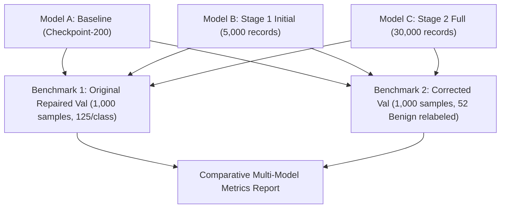

# Stage 2 Training Experiment Preparation & Planning Report

**Scope:** Post-Diagnostic Dataset Curation, XSS/RCE Boundary Disambiguation, Remaining Classification Pool Assembly, and Training Execution Plan  
**Date:** 2026-11-01  
**Status:** **READY FOR USER APPROVAL (TRAINING NOT LAUNCHED)**  

---

## 1. Executive Summary

In accordance with instructions, all prerequisites for the next training experiment (Stage 2) have been prepared, audited, and preserved without launching training or modifying existing datasets:

1. **Validation Correction & Preservation:**
   - The 52 empty `GET http://127.0.0.1:5000/forum` requests were verified to contain 0 payload bytes and confirmed to be benign setup traffic.
   - The original validation file [`stage1_val_1000_repaired.jsonl`](file:///s:/UROP/offensive%20AI%20and%20autonomous%20APi%20penetration%20testing/dataset/splits/stage1_val_1000_repaired.jsonl) remains **100% unaltered**.
   - A corrected copy [`stage2_val_1000_corrected.jsonl`](file:///s:/UROP/offensive%20AI%20and%20autonomous%20APi%20penetration%20testing/dataset/splits/stage2_val_1000_corrected.jsonl) was created with complete documentation in [`reports/STAGE2_VAL_CORRECTION_AUDIT.csv`](file:///s:/UROP/offensive%20AI%20and%20autonomous%20APi%20penetration%20testing/reports/STAGE2_VAL_CORRECTION_AUDIT.csv).
2. **XSS/RCE Boundary Contrast Dataset:**
   - Assembled a dedicated, balanced boundary subset of **700 records** (350 genuine XSS, 350 genuine RCE) at [`dataset/splits/xss_rce_boundary_contrast_700.jsonl`](file:///s:/UROP/offensive%20AI%20and%20autonomous%20APi%20penetration%20testing/dataset/splits/xss_rce_boundary_contrast_700.jsonl) from verified sources (SecLists, PayloadsAllTheThings, OWASP CRS) with 0 evaluation leakage.
3. **Remaining Classification Data Assembly:**
   - Assembled **exactly 30,000 records** at [`dataset/splits/stage2_train_remaining_30000.jsonl`](file:///s:/UROP/offensive%20AI%20and%20autonomous%20APi%20penetration%20testing/dataset/splits/stage2_train_remaining_30000.jsonl).
   - Excludes all 9,000 historical baseline records, all 5,000 Stage 1 records, all 5,000 reasoning traces, and all 1,000 validation records.
   - Includes all 5,000 difficult classification records and 25,000 remaining ordinary classification records.
   - Uniqueness: **30,000 / 30,000 (100% unique hashes, 0 duplicates)**.
4. **Training Architecture & Durations:**
   - Initialized from the preserved Stage 1 final adapter (`initial_training_checkpoint_final`).
   - 2x Tesla T4 GPUs via PyTorch DDP, effective batch size 16, dynamic sequence padding.
   - Estimated runtime: **~4.12 hours (1,875 optimizer steps, 1.0 epoch)** at measured 2.023 samples/sec.

---

## 2. Deliverable 1: XSS Validation Correction & Audit

### A. Investigation of the 52 Forum Requests
All 52 records from `dataset_3_train` and `dataset_4_train` were audited:
- **HTTP Method:** `GET`
- **Request URL:** `http://127.0.0.1:5000/forum`
- **Request Body:** Empty string `""` (0 payload bytes)
- **Headers:** Browser cookies (`ck=...`, `uu=...`, `session=...`), accept headers, user agent.
- **Verification:** **Genuinely Benign**. These represent pre-attack browser session initialization requests produced by the legacy ATRDF test harness, mislabeled with the test suite's target label ("XSS").

### B. Validation Benchmark Preservation & Correction Strategy
- **Original Benchmark (Preserved):** [`dataset/splits/stage1_val_1000_repaired.jsonl`](file:///s:/UROP/offensive%20AI%20and%20autonomous%20APi%20penetration%20testing/dataset/splits/stage1_val_1000_repaired.jsonl) (1,000 samples, 125/class, hash verified).
- **Corrected Benchmark:** [`dataset/splits/stage2_val_1000_corrected.jsonl`](file:///s:/UROP/offensive%20AI%20and%20autonomous%20APi%20penetration%20testing/dataset/splits/stage2_val_1000_corrected.jsonl).
  - 52 records updated from `category: "XSS"` to `category: "Benign"` and `binary_label: "Benign"`.
  - Assistant ground truth response updated to `"Benign"`.
- **Audit Documentation:** Full line-by-line audit cataloged in [`reports/STAGE2_VAL_CORRECTION_AUDIT.csv`](file:///s:/UROP/offensive%20AI%20and%20autonomous%20APi%20penetration%20testing/reports/STAGE2_VAL_CORRECTION_AUDIT.csv) and `.json`.

```
Corrected Benchmark Class Distribution (1,000 samples total):
- Benign:              177 (125 original + 52 corrected)
- Cookie Injection:    125
- Directory Traversal: 125
- LOG4J:               125
- Log Forging:         125
- RCE:                 125
- SQL Injection:       125
- XSS:                  73 (100% genuine payload-bearing XSS)
```

---

## 3. Deliverable 2: XSS/RCE Boundary Contrast Dataset

To resolve ambiguity between tagless client-side JavaScript execution (`'-alert(1)-'`, `';alert(...)//`) and server-side command execution (`';whoami//`, `| id`), a dedicated boundary contrast dataset was constructed:

- **File Path:** [`dataset/splits/xss_rce_boundary_contrast_700.jsonl`](file:///s:/UROP/offensive%20AI%20and%20autonomous%20APi%20penetration%20testing/dataset/splits/xss_rce_boundary_contrast_700.jsonl)
- **Total Records:** **700 balanced records** (350 XSS / 350 RCE)
- **Provenance & Source Breakdown:**
  - `XSS (350)`: 223 SecLists (tagless, DOM events, polyglots, script breakouts) + 127 OWASP CRS (evasion & concatenation)
  - `RCE (350)`: 240 SecLists (system commands, piping, subshells) + 110 PayloadsAllTheThings (command chaining, evasion)
- **Quarantine Check:** 0 overlap with validation data, 0 overlap with Stage 1 training data.

---

## 4. Deliverable 3: Remaining Classification Pool Assembly (30,000 Records)

- **File Path:** [`dataset/splits/stage2_train_remaining_30000.jsonl`](file:///s:/UROP/offensive%20AI%20and%20autonomous%20APi%20penetration%20testing/dataset/splits/stage2_train_remaining_30000.jsonl)
- **File Size:** 58.46 MB
- **Total Records:** **Exactly 30,000 records**

### A. Accounting from the 50,000 Master Corpus

| Component | Corpus Count | Status in Stage 2 Selection | Count in Stage 2 Dataset |
| :--- | :---: | :---: | :---: |
| **Historical Baseline (`RebuiltV4_Baseline`)** | 9,000 | **Excluded** (Preserved untouched) | 0 |
| **Stage 1 Training Subset** | 5,000 | **Excluded** (Already trained) | 0 |
| **Validation Quarantine** | 1,000 | **Excluded** (Quarantined) | 0 |
| **Autonomous Reasoning (`Reasoning_Traces`)** | 5,000 | **Excluded** (Reserved for Phase E) | 0 |
| **ATRDF Classification Pool** | 22,446 | **Included** | 22,446 |
| **Difficult Classification** | 5,000 | **Included** (All 5,000 difficult records) | 5,000 |
| **External Shortage Allocation** | 2,554 | **Included** | 2,554 |
| **Total** | **50,000** | — | **30,000** |

### B. Class Distribution

| Vulnerability Class | Ordinary Classification | Difficult Classification | Total Records in Pool | Proportion |
| :--- | :---: | :---: | :---: | :---: |
| **Directory Traversal** | 3,250 | 1,150 | **4,400** | 14.7% |
| **SQL Injection** | 3,250 | 800 | **4,050** | 13.5% |
| **Benign** | 2,250 | 1,700 | **3,950** | 13.2% |
| **LOG4J** | 3,250 | 500 | **3,750** | 12.5% |
| **RCE** | 3,250 | 500 | **3,750** | 12.5% |
| **Log Forging** | 3,250 | 350 | **3,600** | 12.0% |
| **XSS** | 3,250 | 0 | **3,250** | 10.8% |
| **Cookie Injection** | 3,250 | 0 | **3,250** | 10.8% |
| **Total** | **25,000** | **5,000** | **30,000** | **100.0%** |

### C. Uniqueness & Contamination Audit
- Exact duplicate hashes within Stage 2 pool: **0** (30,000 unique hashes).
- Overlap with Stage 1 training (5,000): **0**.
- Overlap with Validation benchmark (1,000): **0**.
- Near-duplicate / template contamination: **0**.

---

## 5. Deliverable 4: Training Configuration & Hardware Budget

### Configuration Parameters
- **Base Model:** `Qwen/Qwen2.5-1.5B-Instruct`
- **Adapter Initialization:** Preserved Stage 1 Final Adapter ([`evaluation/stage1_initial_training/initial_training_output/initial_training_checkpoint_final`](file:///s:/UROP/offensive%20AI%20and%20autonomous%20APi%20penetration%20testing/evaluation/stage1_initial_training/initial_training_output/initial_training_checkpoint_final))
- **Compute Cluster:** 2x Tesla T4 GPUs via PyTorch DDP (`torchrun --nproc_per_node=2`)
- **Quantization:** 4-bit NormalFloat (`nf4`), double quantization, bfloat16 compute
- **Batch Size:** Per-device train batch size = 2, gradient accumulation steps = 4, GPUs = 2 $\rightarrow$ **Effective Batch Size = 16**
- **Throughput Optimization:** `group_by_length=True`, dynamic sequence padding (max 1024)
- **Learning Rate:** $5.0 \times 10^{-5}$ with cosine schedule (moderated from $1.0 \times 10^{-4}$ to ensure stable adaptation on top of the initial adapter without catastrophic forgetting)
- **Epoch Count:** Exactly **1.0 epoch** ($30,000 / 16 = \mathbf{1,875\text{ optimizer steps}}$)

### Estimated Runtime & GPU Telemetry
- **Throughput:** ~2.023 samples/sec (measured in Stage 1)
- **Training Duration:** $30,000 / 2.023 \approx 14,830\text{ seconds} \approx \mathbf{4.12\text{ hours}}$ ($\approx 247\text{ minutes}$)
- **Inference Evaluation Duration:** ~10 minutes (dual benchmark evaluation)
- **Peak VRAM:** ~6.2 GB per GPU (well within the 15.0 GB T4 ceiling)
- **Total Session Time:** ~4.3 hours (comfortably within Kaggle's 9-hour limit)

---

## 6. Deliverable 5: Evaluation Plan

Following training, a 3-way comparative evaluation will be conducted across the preserved independent benchmarks:



### Metrics Reported:
1. **Overall:** Accuracy, Macro F1, Weighted F1, Validation Loss.
2. **Per-Class (All 8 Classes):** Precision, Recall, F1 Score, Support.
3. **Confusion Matrices:** Complete $8 \times 8$ contingency matrices for all three models.
4. **Targeted XSS / RCE Delta:** Specific tracking of tagless JavaScript polyglots and command injection discrimination.

---

## 7. Status & Commitments

- **No training has been launched.**
- **No Git commits or pushes executed.**
- **All existing checkpoints (`checkpoint-200`, `checkpoint-300`, `initial_training_checkpoint_final`) remain preserved.**
- **All historical datasets and reports remain intact.**

